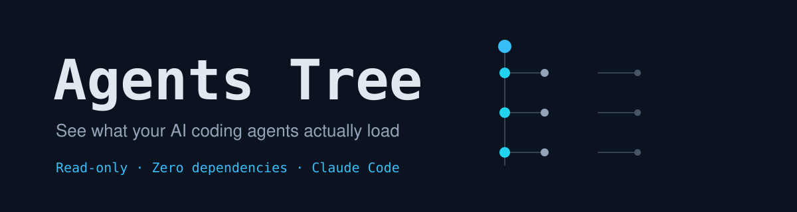

<p align="center">
  
</p>

<p align="center">
  
  
  
  
</p>

# Agents Tree

A tree view of what your AI agent actually loads: enabled and disabled skills,
plugins, MCP servers, hooks, and memory files (`CLAUDE.md`, `AGENTS.md`).

**Read-only.** It never writes, moves or deletes anything, and it never reads
your conversations. Python standard library only, no dependencies.

> Status: 0.1, experimental. Claude Code is the only supported agent for now.

## 🚀 Usage

```bash
git clone https://github.com/ApexMene/agents-tree
cd agents-tree
python3 -m agents_tree.cli                       # tree in the terminal
python3 -m agents_tree.cli --json                # JSON for scripts
python3 -m agents_tree.cli --project ~/work/app  # include project-scope config
```

Or install it:

```bash
pip install .
agents-tree --project .
```

## 🔍 What it reads, exactly

| Source | What it extracts |
|---|---|
| `~/.claude/settings.json` | `skillOverrides` (skill on/off), `enabledPlugins`, `hooks`, `mcpServers` |
| `~/.claude.json` | user-scope and per-project MCP servers |
| `~/.claude/skills/*/SKILL.md`, `~/.agents/skills/*/SKILL.md` | name, description, symlink target |
| `<project>/.mcp.json`, `<project>/CLAUDE.md`, `<project>/AGENTS.md` | only for folders passed with `--project` |

It does not read `~/.claude/projects` (transcripts) and does not scan your home
directory. MCP environment values are never printed: you only see the variable names.

## 💡 Why it exists

With many skills and MCP servers, it becomes unclear what actually runs in a
session. This tool shows it without touching your configuration.

## ✅ Pros

- See at a glance which skills are active and which overrides exist.
- Find stale or duplicated entries in your config.
- Zero dependencies, one small Python adapter.
- JSON output makes it easy to use in scripts or periodic checks.

## ⚠️ Cons

- **Claude Code only.** Codex, Antigravity, Kiro, OpenCode and Gemini CLI are not supported yet.
- **Unofficial formats.** It reads Claude Code's internal files. If they change, a field can disappear without an error. The test `test_missing_files_do_not_crash` covers "file missing", not "field changed".
- **No token cost yet.** Per-skill context cost is not calculated. It was removed from 0.1 because the estimate needs to be done properly.
- **No writes.** To disable a skill you still have to do it by hand or with the official tooling.
- **One maintainer.** No guaranteed response times.

## 🤝 Contributing

More agents need more people. To add one:

1. Create `agents_tree/<agent>.py` with a `scan(home, projects) -> dict` function that returns the same shape as `agents_tree/claude.py`.
2. Add tests under `tests/`.
3. Open a PR that lists the source files it reads.

Tests: `python3 -m unittest discover -s tests`

## 📄 License

MIT, see [LICENSE](LICENSE).
