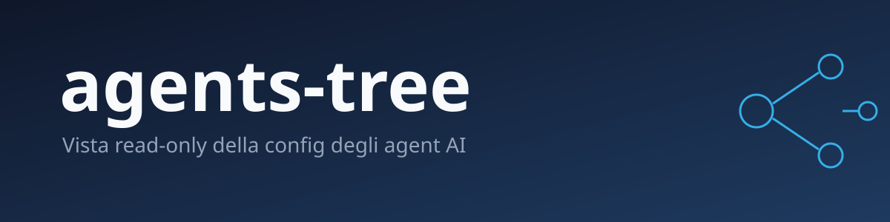

<p align="center">
  
</p>

<p align="center">
  
  
  
  
</p>

# agents-tree

Un albero di cosa il tuo agent AI carica davvero: skill attive e disattivate,
plugin, server MCP, hook, file di memoria (`CLAUDE.md`, `AGENTS.md`).

**Sola lettura.** Non scrive, non sposta, non cancella nulla. Non legge le
conversazioni. Usa solo Python standard, nessuna dipendenza.

> Stato: 0.1, sperimentale. Per ora supporta solo Claude Code.

## Uso

```bash
git clone https://github.com/ApexMene/agents-tree
cd agents-tree
python3 -m agents_tree.cli                       # albero in terminale
python3 -m agents_tree.cli --json                # JSON per script
python3 -m agents_tree.cli --project ~/work/app  # include config di progetto
```

Con installazione:

```bash
pip install .
agents-tree --project .
```

## Cosa legge, esattamente

| Dove | Cosa ricava |
|---|---|
| `~/.claude/settings.json` | `skillOverrides` (skill on/off), `enabledPlugins`, `hooks`, `mcpServers` |
| `~/.claude.json` | server MCP a livello utente e per progetto |
| `~/.claude/skills/*/SKILL.md`, `~/.agents/skills/*/SKILL.md` | nome, descrizione, symlink |
| `<progetto>/.mcp.json`, `<progetto>/CLAUDE.md`, `<progetto>/AGENTS.md` | solo per le cartelle passate con `--project` |

Non legge `~/.claude/projects` (i transcript) e non scansiona la home.
I valori delle variabili d'ambiente dei server MCP non escono mai: vedi solo i nomi.

## Perché esiste

Con molte skill e server MCP non si capisce più cosa parte in una sessione.
Questo tool lo mostra senza toccare la config.

## Pro

- Vedi subito il perimetro: quali skill sono attive, quali override esistono.
- Trovi voci vecchie o duplicate nella config.
- Zero dipendenze, un file Python per l'adapter.
- Il JSON permette di metterlo in uno script o in un controllo periodico.

## Contro

- **Solo Claude Code.** Gli altri agent (Codex, Antigravity, Kiro, OpenCode, Gemini CLI) non sono ancora supportati.
- **Formati non ufficiali.** Il tool legge file interni di Claude Code. Se cambiano, un campo può sparire senza errore: il test `test_missing_files_do_not_crash` copre il caso "file assente", non quello "campo cambiato".
- **Nessun costo in token.** Il costo di contesto per skill non è ancora calcolato. È stato rimosso dalla 0.1 perché la stima andava fatta bene.
- **Nessuna scrittura.** Se vuoi disattivare una skill devi farlo a mano o con lo strumento ufficiale.
- **Maintainer di un solo progetto.** Nessuna garanzia di tempi di risposta.

## Contribuire

Serve più di una persona per gli altri agent. Per aggiungerne uno:

1. crea `agents_tree/<agent>.py` con una funzione `scan(home, projects) -> dict` che restituisce la stessa forma di `agents_tree/claude.py`;
2. aggiungi i test in `tests/`;
3. apri una PR con le fonti dei file letti.

Test: `python3 -m unittest discover -s tests`

## Licenza

MIT, vedi [LICENSE](LICENSE).
